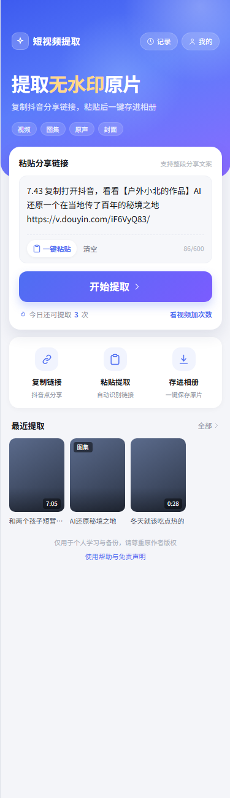
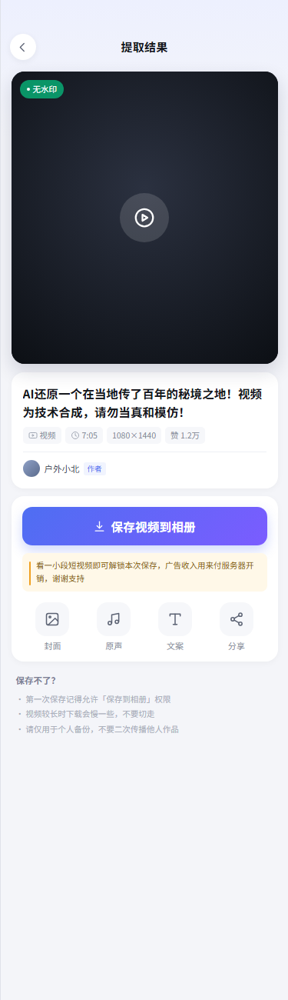
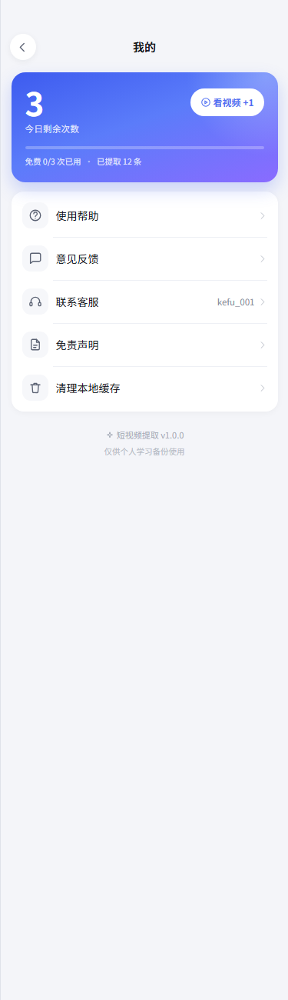
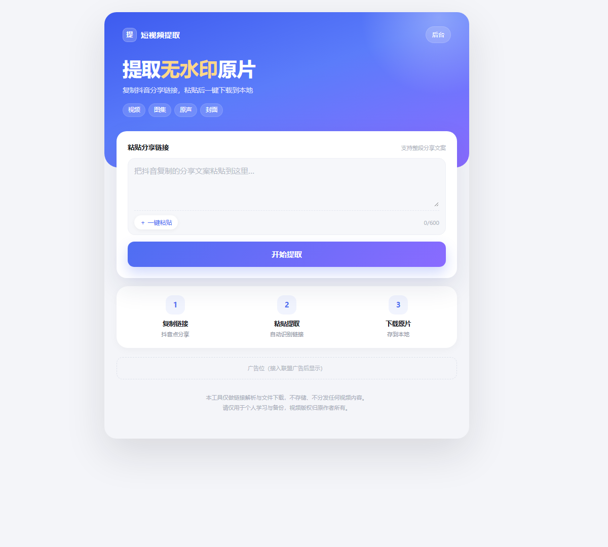

# 短视频提取工具

> 复制抖音分享链接 → 提取无水印原片 → 手机存相册 / 电脑存桌面

版本 1.0.0

微信小程序 + 网页版双端，后端自带运营后台和广告位。手机、电脑浏览器都能用。


---

## 它解决什么问题

抖音 2026 年起给 Web 接口加了 Argus 风控。纯服务端请求即使签名算对了，也会被拦：

```
403 Blocked by ArgusSecurityPlugin Uifid Not Found
```

`UIFID` 只能由真实浏览器环境签发，所以市面上基于 `iteminfo` 接口的老方案、基于分享页 SSR 的方案全部失效。

这个项目的做法是：**复用一份真实 Chrome，在页面上下文里调用官方接口**，签名由页面自己的 SDK 完成。

```
小程序 / 网页
      │  粘贴链接
      ▼
   后端 ── 1. 解析短链拿作品 ID（纯 HTTP，毫秒级）
      ├── 2. 无头 Chrome 预热一次抖音页面
      ├── 3. 页面内 fetch 官方详情接口（SDK 自动签名）
      ├── 4. 取 play_addr 里的无水印直链
      └── 5. 签名生成下载地址，反代 CDN 流量
```

实测：预热后单条解析 **0.2 ~ 0.5 秒**，不用登录、不用维护 Cookie 池。

---

## 效果

| 首页 | 结果页 | 我的 | 网页版 |
|:---:|:---:|:---:|:---:|
|  |  |  |  |

---

## 功能

**提取**
- 视频无水印原片（1080P 直链）
- 图集一次性保存全部图片
- 原声 MP3 单独下载
- 封面图下载
- 整段分享文案直接粘贴，自动识别链接

**多端**

| 端 | 保存方式 |
| --- | --- |
| 手机微信小程序 | 存入手机相册 |
| 电脑微信小程序 | 弹「另存为」，可选文件夹 |
| 浏览器（手机/电脑） | 浏览器下载目录，可设「每次询问保存位置」 |

**运营**
- 运营后台：实时成功率、平均耗时、失败原因 Top、7 天趋势、用户反馈
- 广告位：激励视频 / Banner / 插屏，改配置不用重新发版
- 每日免费额度 + 看广告加次数
- 签名下载链接（HMAC），防止被外部盗链刷流量

---

## 快速开始

### 1. 后端

```bash
cd douyin-tool/server
python app.py
```

零第三方依赖，Python 3.10+ 直接跑。首次启动会自动生成 `config.json`（含后台密码和签名密钥）。

需要本机装有 Chrome 或 Edge，程序会自动探测路径；找不到就在 `config.json` 里指定：

```json
"parse": { "chrome_path": "/usr/bin/google-chrome" }
```

启动后输出：

```
[ok] 浏览器就绪：/usr/bin/google-chrome
[ok] 预热标签页 2 个
[ok] 后台地址：http://0.0.0.0:8000/admin?token=xxxxxxxx
```

### 2. 网页版

浏览器打开 `http://127.0.0.1:8000/` 即可，不需要额外部署前端。

### 3. 微信小程序

用微信开发者工具导入**仓库根目录**（`app.json` 就在根目录），填自己的 AppID，然后：

- 详情 → 本地设置 → 勾选「不校验合法域名」
- 改 `config.js` 里的 `baseUrl`：
  - 模拟器：`http://127.0.0.1:8000`（代码已按环境自动切换，`devBaseUrl`）
  - 真机：填电脑局域网 IP，如 `http://192.168.1.10:8000`

真机调试时如果 IP 变了，不用改代码，在「我的 → 服务器地址」里改一下就行。

---

## 目录结构

```
.
├── app.js / app.json / app.wxss    小程序入口（项目根即小程序根）
├── config.js                       后端地址、广告位
├── pages/                          5 个页面：首页/结果/记录/我的/帮助
├── components/ad-banner/           Banner 广告组件
├── styles/icons.wxss               内联 SVG 图标（脚本生成）
├── utils/                          请求、广告、本地存储、隐私授权
└── douyin-tool/
    ├── server/                     后端（标准库，零依赖）
    │   ├── app.py                  路由、下载代理、后台接口
    │   ├── core/browser.py         CDP 浏览器池（自实现 WebSocket 客户端）
    │   ├── core/douyin.py          短链解析、字段归一化
    │   ├── core/db.py              SQLite：记录/缓存/反馈
    │   ├── core/admin.py           运营后台页面
    │   ├── core/signing/           a_bogus 签名（Apache-2.0，见 NOTICE）
    │   └── web/index.html          网页版
    ├── docs/                       部署指南 / 上线与广告 / 维护手册
    └── tools/                      图标生成、页面预览、头像生成
```

---

## 部署

完整步骤见 [`douyin-tool/docs/部署指南.md`](douyin-tool/docs/部署指南.md)，要点：

- 服务器 2C2G 起（Chrome 常驻约 300–500MB）
- 域名需 ICP 备案，配 HTTPS
- Nginx 反代时关掉 `proxy_buffering`（视频流式输出）
- systemd 常驻 + `/api/health` 监控

上线流程、类目选择、广告位接入见 [`小程序上线与广告接入.md`](douyin-tool/docs/小程序上线与广告接入.md)。
故障排查见 [`维护手册.md`](douyin-tool/docs/维护手册.md)。

---

## 已知限制

- 抖音改接口或风控升级时，需同步 `parse` 参数或签名实现，参考 `core/browser.py` 与 `core/signing/`
- 直播回放、付费内容、企业号特定内容抓不到播放地址
- 微信小程序 `wx.downloadFile` 单文件上限 200MB，超长视频走网页版
- 电脑端保存依赖 `wx.saveFileToDisk`（基础库 2.16.0+）

---

## 免责声明

本项目仅用于**技术研究与个人学习备份**。

- 工具只做链接解析与文件下载，不存储、不分发任何视频内容
- 视频版权归原作者及平台所有，请勿用于商业用途、二次上传、搬运涨粉
- 因使用不当产生的版权纠纷、平台处罚，由使用者自行承担

如果权利人认为本项目侵权，请通过 Issue 联系，会及时处理。

---

## 致谢

- [Evil0ctal/Douyin_TikTok_Download_API](https://github.com/Evil0ctal/Douyin_TikTok_Download_API) — `a_bogus` 签名实现、抖音接口参数集（Apache-2.0）
- [JoeanAmier/TikTokDownloader](https://github.com/JoeanAmier/TikTokDownloader) — 字段结构对照参考

---

## License

[Apache-2.0](LICENSE)
